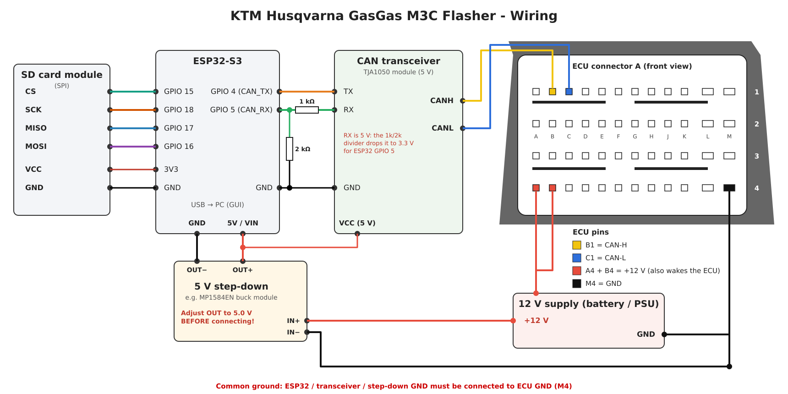

# KTM Husqvarna GasGas M3C Flasher

An ESP32-based tool for reading and writing the Continental/Bosch **M3C** ECU
(MC9S12-based) used on KTM/Husqvarna/GasGas TPI models over the CAN bus,
without commercial flashing software.

The protocol is fully **reverse-engineered**: it was reconstructed by sniffing
CAN bus traffic (SavvyCAN + CANable v2) while a commercial tool was running,
not from documentation (no official documentation is publicly available).

> ⚠️ **WARNING: READ BEFORE USE**
>
> This is a hobby project, not an official or supported tool. Writing ECU
> flash is **irreversible and can permanently damage ("brick") your
> motorcycle's ECU**. The author(s) accept no liability for any damage
> resulting from the use of this tool. Use entirely at your own risk.
>
> - Always do a **READ** first and store the original file safely before
>   any write.
> - Do not interrupt power during a write.
> - The diagnostic (DTC/Live Data) commands are **best guesses**, not
>   confirmed from a CAN log (see below).

This project is not affiliated with or endorsed by KTM AG, Continental AG,
Bosch GmbH or any other trademark mentioned.

---

## Project status

- ✅ **Tested and working on one (1) M3C ECU only.** Other ECU variants,
  model years or software versions may behave differently. If you test it
  on another ECU, please open an issue and report the result.
- ✅ **Checksum correction is built into the flasher.** Before every write
  the file's checksums are verified. If one is wrong, a corrected copy
  (`<name>_CHK_OK.bin`) is created on the SD card, re-verified from scratch
  and written instead of the original. A standalone checker/fixer is also
  available ([`tools/m3c_checksum_gui.py`](tools/m3c_checksum_gui.py)).
  See [Checksum correction](#checksum-correction).

## Hardware

- ESP32-S3 (or another ESP32 with a CAN transceiver)
- CAN transceiver module connected to the ECU CAN-H/CAN-L lines (500 kbit/s).
  The diagram uses a **TJA1050** module (5 V). Its RX output is 5 V, so it
  goes to the ESP32 through a **1 kΩ / 2 kΩ voltage divider** (see below).
  A 3.3 V transceiver (e.g. SN65HVD230) can be connected directly to 3V3
  instead, without the divider.
- SD card module (SPI)
- 12 V power supply for the ECU (battery or bench PSU)
- 5 V step-down (buck) module, e.g. MP1584EN mini module, to power the
  ESP32 from the same 12 V (not needed if the ESP32 is powered over USB)
- (optional) an Android phone for the Bluetooth app, or any phone/browser
  for the WiFi web interface

> Bluetooth needs an ESP32 with BLE (ESP32, ESP32-S3, ESP32-C3...). The
> ESP32-S2 has no Bluetooth - use the WiFi web interface or USB there.

## Wiring



**ECU connector A** (front view, pins marked in the diagram):

| ECU pin | Function |
|---------|----------|
| B1 | CAN-H |
| C1 | CAN-L |
| A4, B4 | +12 V (also acts as ignition, no separate ignition pin needed) |
| M4 | GND |

**ESP32 pins** (defined at the top of `firmware/ktm_m3c_flasher.ino`):

| ESP32 | Connects to |
|-------|-------------|
| GPIO 4 (`CAN_TX`) | Transceiver TX |
| GPIO 5 (`CAN_RX`) | Transceiver RX, through the 1 kΩ / 2 kΩ divider |
| GPIO 15 | SD card CS |
| GPIO 18 | SD card SCK |
| GPIO 17 | SD card MISO |
| GPIO 16 | SD card MOSI |
| 3V3 / GND | SD card VCC / GND |
| 5V / VIN | 5 V step-down OUT+ and transceiver VCC |
| GND | 5 V step-down OUT−, transceiver GND |

**RX voltage divider** (needed with the 5 V TJA1050): transceiver RX →
1 kΩ → ESP32 GPIO 5, and GPIO 5 → 2 kΩ → GND. This brings the 5 V RX
signal down to about 3.3 V; ESP32 pins are not 5 V tolerant. TX needs no
divider - the TJA1050 accepts the ESP32's 3.3 V signal.

**5 V step-down** (e.g. MP1584EN): IN+ → +12 V (same supply as ECU A4/B4),
IN− → GND (ECU M4), OUT+ → ESP32 5V/VIN + transceiver VCC,
OUT− → ESP32 GND + transceiver GND.

> ⚠️ These modules often come set to a higher output voltage. Turn the
> trimmer until a multimeter shows **5.0 V** on OUT+/OUT− **before**
> connecting the ESP32, otherwise the ESP32 can be destroyed.

> ESP32/transceiver/step-down GND **must** be connected to the ECU GND (M4),
> otherwise CAN communication will not work.

## Structure

```
firmware/
  ktm_m3c_flasher.ino   - Main Arduino sketch (CAN protocol, Connect/Read/Write)
  blocks.h              - Calibration blocks written to the ECU during Connect
  checksum.h            - Built-in CRC-16/MODBUS checksum check and correction
  ble_link.h            - Bluetooth LE link (Nordic UART Service) for the Android app
  diagnostics.h         - DTC/Live Data (BEST GUESS, unconfirmed - see warning in file)
  webui.h               - WiFi/phone web interface (Connect/Read/Write/SD files)
gui/
  ktm_m3c_flasher_gui.py - Desktop Python/Tkinter GUI (over USB Serial)
tools/
  m3c_checksum_gui.py    - Standalone checksum checker/fixer (Python/Tkinter)
android/                 - Android app (Kotlin/Jetpack Compose, Bluetooth LE)
```

## Protocol summary

Everything below has been verified against CAN logs at the transaction level,
with no dropped frames. See the code comments in `ktm_m3c_flasher.ino` for
details.

- **Diagnostic request/response ID:** `0x7E0` / `0x7E8`
- **CONNECT:** session (0x3E) → read ECU ID (VIN/Cal/Date/Ver, service
  0x1A) → security access seed/key (0x7D) → write 36 calibration blocks →
  second seed/key confirmation → 3× closing handshake
- **READ:** `52 00 PAGE COUNTER 00 01 00 00` for each 256-byte address,
  1024 addresses in total (4 pages × 256), response is 32×8 raw frames
- **WRITE:** 5 phases: erase Section 1 (128×`45`) → write Section 1
  (512×`02`+`57` pairs) → erase Section 2 → write Section 2 →
  end session (`01 00 00 02 01`)
- **"Disconnect":** there is no software command; the ECU state is only reset
  by a physical power cycle (same as the commercial software)

The write protocol has been tested on hardware: a full 256KB write +
read-back matches byte for byte.

## Usage

1. Open the `firmware/` folder in the Arduino IDE, select the ESP32-S3 board,
   set **Tools → Partition Scheme → Huge APP (3MB No OTA/1MB SPIFFS)**
   (WiFi + Bluetooth do not fit into the default partition) and upload.
2. Use one of the three interfaces - they all talk to the same firmware:
   - **Desktop:** connect over USB and run `gui/ktm_m3c_flasher_gui.py`
     (`pip install pyserial`).
   - **Android app:** see [Android app](#android-app) below.
   - **Web:** connect your phone to the WiFi network `M3C_Flasher`
     (password `flasher123`) and open `192.168.4.1` in a browser.
3. The desktop GUI loads the SD card file list as soon as it starts - you can
   upload, download and delete SD files without connecting to the ECU.
4. Press CONNECT, then READ FLASH before attempting any write.
5. **RESET ESP32** (desktop GUI and web page) restarts the ESP32 if anything
   gets stuck. After a reset, press CONNECT again.

## Android app

The `android/` folder contains a native Android app (Android 8.0+) that
connects to the ESP32 over **Bluetooth LE**. The ESP32 advertises as
`M3C_Flasher` using the Nordic UART Service, and the app uses the same text
protocol as the desktop GUI.

Features: ECU CONNECT (VIN, calibration, date, version), READ FLASH to the SD
card, SD card file list, upload from / save to the phone, delete,
**WRITE TO ECU** with status and progress bar (checksum check → erase →
write), ESP32 reset and the wiring diagram.

If Bluetooth drops during a write, the ESP32 finishes the write on its own -
do not switch off the ignition; reconnect after a few minutes.

**Building and installing** (no prebuilt APK yet):

1. Install [Android Studio](https://developer.android.com/studio) and open
   the `android/` folder.
2. On the phone enable **Developer options** (tap *Build number* 7 times) and
   **USB debugging**, then connect it with a USB cable.
   (Samsung: also turn off *Settings → Security and privacy → Auto Blocker*.)
3. Select the phone at the top of Android Studio and press **Run ▶**.

You can also test the Bluetooth link without the app, using any BLE UART
terminal (e.g. nRF Connect): send `PING` followed by a newline and the ESP32
answers `PONG`.

## Checksum correction

The M3C flash contains several checksum blocks. Each one starts with
`FF FF FF FF`, followed by a big-endian **CRC-16/MODBUS** and a list of the
address ranges it covers. A 256 KB read has four of them; a tune normally
only changes the calibration block at `0x6804`.

**The flasher does this automatically before every write** (see Project
status). The log shows each checksum block as OK or BAD, and the corrected
file appears in the SD card list as `<name>_CHK_OK.bin`. The same file name
is reused on every attempt, and a corrected copy that fails the self-check
is deleted instead of being left on the card.

To check or fix a file on your computer before uploading it,
`tools/m3c_checksum_gui.py` does the same thing. It uses only the Python
standard library (no `pip install` needed):

1. Run `python tools/m3c_checksum_gui.py` (or double-click it on Windows).
2. **Open file** and select your `.bin`. The panel turns **green** (checksum
   OK) or **red** (checksum needs correcting).
3. If red, press **Recalculate CHK**, then **Save**. The tool re-checks every
   block after fixing and refuses to continue if anything is still wrong.
4. Upload the saved file to the SD card and write it to the ECU.

> Tip: open your **unmodified original read** first. It should show green.
> If it doesn't, please open an issue before writing anything.

An in-browser version (no installation) is also available from NetworkDir:
[networkdir.github.io/moto-ecu-checksum](https://networkdir.github.io/moto-ecu-checksum/).

## Contributing

Help is very welcome! You can contribute in several ways:

- **Report test results:** tried it on another ECU or bike? Open an
  [issue](../../issues) with the bike model, year, ECU software version and
  whether Connect/Read/Write worked.
- **Report bugs:** open an issue describing what happened, ideally with the
  Serial log output.
- **Fix or improve the code:** fork the repository, make your changes and
  open a [pull request](../../pulls). Please describe what you changed and
  how you tested it.

Areas where help is especially needed:

- Support and testing on **other M3C variants / model years**
- Confirming the **DTC / Live Data** commands with real CAN logs

> ⚠️ Please do **not** upload full ECU dumps (`.bin`) or raw CAN logs to
> issues. They can contain your VIN and other identifying data.

## License

See [LICENSE](LICENSE).

---

## Credits

All code in this project was written with [Claude AI](https://claude.ai).
CAN bus logging and hardware testing were done by
[Oliver942701](https://github.com/Oliver942701).
The M3C checksum algorithm was identified by
[NetworkDir](https://github.com/NetworkDir) - see
[moto-ecu-checksum](https://github.com/NetworkDir/moto-ecu-checksum).

<sub>Powered by [Claude AI](https://claude.ai)</sub>
